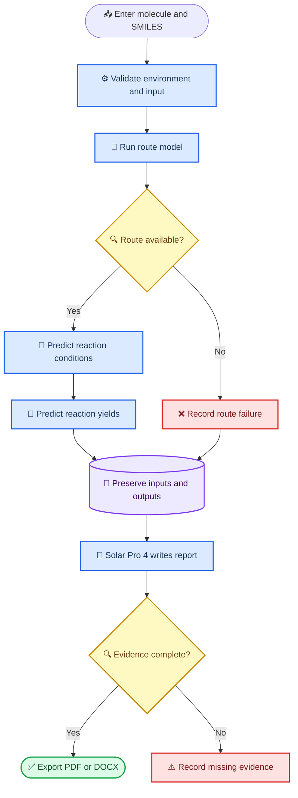

# AI 신약 유기합성 기말 프로젝트

_기말 제출을 위한 재현 가능한 AI 유기합성 분석 파이프라인 — 대상 물질과 모델 조합은 추후 실제 실행으로 확정합니다._

---

## 📋 프로젝트 목적

물질명과 SMILES를 입력으로 받아 합성 경로, 단계별 반응 조건, 예상 수율을 실제 모델 결과로 수집하고, Solar Pro 4가 이를 통합한 최대 20페이지의 최종 보고서를 생성하는 재사용 가능한 Skill을 제작합니다.

이 저장소의 기준은 [`docs/project_requirements.md`](docs/project_requirements.md)에 정리한 기말 프로젝트 요구사항입니다. 현재는 **기말 프로젝트 시작 전 환경과 문서 뼈대만 준비된 상태**이며, 실행하지 않은 모델의 결과나 미정인 값을 실제 결과로 기록하지 않습니다.

## 🔄 예정 파이프라인

## 📦 제출용 구조

| 경로 | 제출 역할 | 현재 상태 |
|---|---|---|
| [`skill/`](skill/README.md) | 경로·조건·수율 분석 및 Solar Pro 4 보고서 생성을 위한 Skill | 실행 전 뼈대 완료 |
| [`report/`](report/README.md) | Solar Pro 4가 생성한 최종 PDF 또는 DOCX | 최종 실행 후 추가 |
| [`inputs/`](inputs/README.md) | 대상 물질의 재현 가능한 입력 JSON | 예시만 포함 |
| [`runs/`](runs/README.md) | 최종 모델별 원본 출력, 오류 및 구조 이미지 | 최종 실행 전 비어 있음 |
| [`docs/`](docs/README.md) | 계획, 모델 선정 근거 및 재현 절차 | 초기 문서 완료 |
| [`config/`](config/README.md) | 로컬 모델·자산 경로·실행 한도 설정 | 실제 값 미정 |

## ⚙️ 시작 순서

1. [`docs/project_plan.md`](docs/project_plan.md)의 미확정 사항을 결정합니다.
2. `config/project.template.yaml`을 복사해 Git에 올리지 않는 `config/project.local.yaml`을 만듭니다.
3. `inputs/target.example.json`을 실제 대상 물질 정보로 교체합니다.
4. [`skill/SKILL.md`](skill/SKILL.md)를 Solar Pro 4가 읽을 수 있는 하네스에서 실행합니다.
5. 실제 모델 출력과 오류를 새 `runs/<run-id>/`에 보존하고, Solar Pro 4가 생성한 최종 보고서를 `report/`에 저장합니다.

> ⚠️ **보안:** API 키, 토큰, 라이선스가 필요한 모델 자산, 대용량 가중치는 저장소에 넣지 않습니다. 설치 경로·버전·받는 방법만 문서화합니다.

## 🎯 제출 전 확인

- [ ] 대상 물질의 이름, SMILES, 선정 이유를 기록했다
- [ ] 경로·조건·수율 각 분야의 실제 모델 결과 또는 실패 사유를 기록했다
- [ ] 구조식 이미지와 단계별 반응물을 보고서에 포함했다
- [ ] 모델 버전, 입력, 설정, 원본 출력 및 오류 로그를 보존했다
- [ ] Solar Pro 4가 Skill을 읽고 최종 PDF 또는 DOCX를 작성했다
- [ ] 보고서가 20페이지 이하이며 AI 예측과 실험값을 명확히 구분한다
